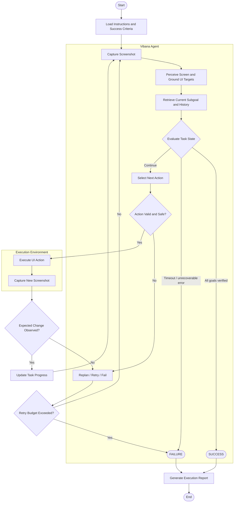

# Vibana Agent

> Vibana - Vision-based UI Navigation Agent

Group: _Quantity_ **>>>>>** _Quality_

Members:

| Name              | Account    | GitLab |
| ----------------- | ---------- | ------ |
| Nguyen Chi Cuong  | CuongNC62  |        |
| Tran Le Duy       | DuyTL3     |        |
| Dang Truong Hung  | HungDT57   |        |
| Phan Thuy Phuong  | PhuongPT71 |        |
| Nguyen Hoang Quan | QuanNH111  |        |

## Architecture Overview

